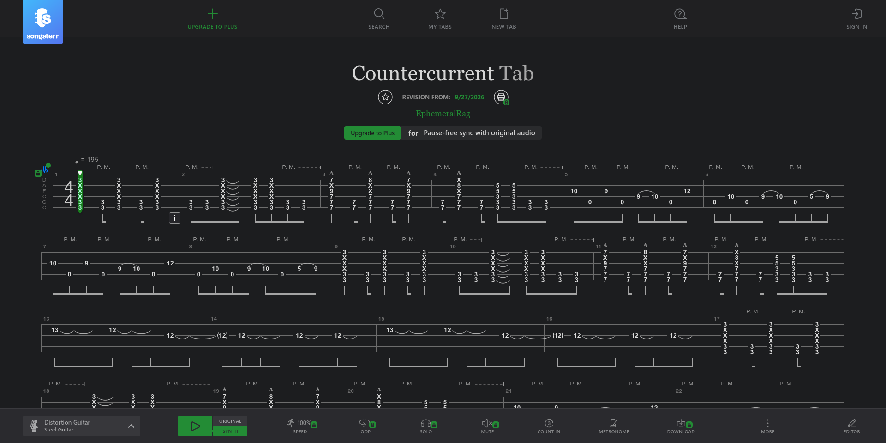
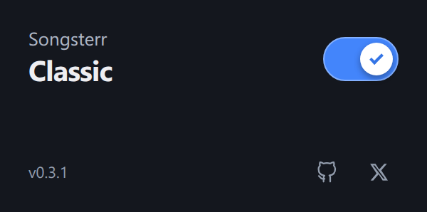

# Songsterr Classic

The older Songsterr interface, one switch away. For Chrome and Firefox.

*On the score: [Countercurrent](https://www.songsterr.com/a/wsa/ephemeralrag-countercurrent-tab-s6835900), by me! 🌚*

I preferred Songsterr's older layout, so I made a switch to bring it back.
Classic restores the July interface while keeping songs, playback and your
account connected to Songsterr.

**On** brings back Classic. **Off** returns to the current interface.
The setting applies to one tab and resets when you restart the browser.
Switching reloads the tab, so save your edits first.

## Install

Get the package for your browser from
[Releases](https://github.com/Raghav-B/songsterr-classic/releases), under
**Assets**. Use the Chrome ZIP or Firefox XPI—not GitHub's **Source code** archives.

*The first public release is being prepared. The steps below describe the
download and installation process.*

### Chrome

1. On the Releases page, download `songsterr-classic-0.3.1-chrome.zip`.
2. Extract the ZIP somewhere you'll keep it.
3. Open `chrome://extensions` and enable **Developer mode**.
4. Choose **Load unpacked**, then select the extracted **extension** folder.
5. Open a song on Songsterr. Click **Extensions → Songsterr Classic** and turn
   the switch on. Pin it to the toolbar if you'd like it within reach.

Keep the extracted folder—Chrome loads the extension from there. To update,
replace its files and click **Reload** on its card in `chrome://extensions`.

### Firefox

The XPI is unsigned. Use Firefox's temporary add-on loader—no signing is
needed for this installation method:

1. On the Releases page, right-click `songsterr-classic-0.3.1-firefox.xpi`
   and choose **Save Link As…**. Save it without extracting it.
2. Open `about:debugging#/runtime/this-firefox`.
3. Choose **Load Temporary Add-on** and select the downloaded XPI.
4. Open a Songsterr song, then use **Extensions → Songsterr Classic**.

**Firefox removes this temporary add-on when it closes.** Load the saved XPI
again with steps 2–3 after restarting. To update, download the newer XPI,
remove the old temporary add-on on the same debugging page, and load the new one.
No changes to Firefox's signature-check settings are needed.

### Remove

Turn Classic off, then remove it from your browser's extension manager.
Reload any open Classic tabs afterward.

## Before you use it

Tab viewing, the mixer, synth playback and local editing with undo/redo have
been checked in both browsers. **Saving and reopening edits is not yet
verified end to end.** Try a disposable private song before relying on it for
your own work. Features introduced after the older interface may be missing.

You still need an internet connection and your usual Songsterr account or
subscription for features that require one.

## Build or contribute

Both browsers use the same popup, editor and compatibility code. Firefox adds
a small loader and its own manifest. See [development](docs/development.md)
for builds and tests, or [open an issue](https://github.com/Raghav-B/songsterr-classic/issues)
with the browser version and steps to reproduce a problem. Please leave out
cookies, account details and private songs.

Made by [Raghav](https://x.com/EphemeralRag).
[Privacy](PRIVACY.md) · [Third-party materials](THIRD_PARTY.md)

---

An independent project for educational and interoperability research. Not
affiliated with or endorsed by Songsterr. Songsterr’s trademarks and frontend
assets belong to their respective owners. Existing account permissions and
subscription requirements still apply. Provided as-is, without warranty.
